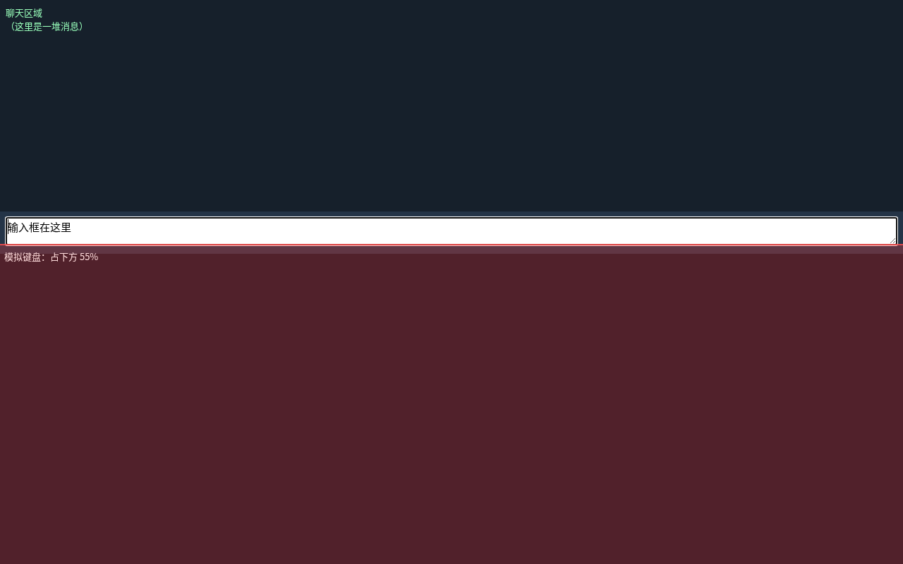

# dsh-osk-lift

给 **DSH（DeepSeek Harness）Web GUI** 用的屏幕键盘补丁：**输入框获得焦点时，把界面压到屏幕上方 45%**，把下面整块让给屏幕键盘，输入框再也不会被挡住。

为 Steam Deck / SteamOS 桌面模式（或任何用覆盖式屏幕键盘的 Linux 桌面）写的，但本质上是普通网页行为，任何浏览器、任何平台都能用。



> 图里下方红色区域是**模拟的屏幕键盘**（占 55%），输入框会自动停在 45% 这条线以上。
> 顺手还把发送键 / 麦克风按钮的可点范围四周各外扩了 8px（视觉大小不变，手指按偏一点也能中）。

## 为什么需要它

- **安卓**：输入法是系统级 IME，弹出时窗口会收到 `adjustResize` / `adjustPan`，应用自己让开。
- **Linux 桌面**：屏幕键盘只是一个覆盖窗口（Steam 的键盘更是 Steam 自己的覆盖层），
  它不改变网页窗口大小，网页根本不知道被挡住了 —— 所以只能由网页自己判断
  「有输入框获得焦点」，然后把自己压到上半屏。

本插件做的事就这一件，顺带修了两个触摸场景的坑：

1. 点输入区里的按钮（发送 / 麦克风 / + / 权限 / 模型）**不会**让界面弹回全屏；
2. 按钮类控件**不会**在 `pointerdown` 时改变布局 ——
   否则界面一变高，手指底下的按钮就弹走了，浏览器会认为「按下和抬起不在同一个元素上」，这次点击直接被吞掉。

## 安装

```bash
git clone https://github.com/kxSenlin/dsh-osk-lift.git
cd dsh-osk-lift
./install.sh          # 默认挂到 web profile；也可 ./install.sh 其他profile
```

脚本只是往 `~/.dsh/profiles/web/cordis.patch.yml` 追加一段：

```yaml
- insert:
    - id: osk-lift
      name: "/绝对路径/dsh-osk-lift/plugin.mjs"
```

然后**刷新浏览器页面**就生效（dsh 支持 profile 补丁热加载，不用重启 `dsh web`）。

也可以手动加这段 YAML，或者把本仓库作为依赖装进 profile：

```bash
dsh plugin --profile web add github:kxSenlin/dsh-osk-lift
# 然后 patch 里写 name: dsh-osk-lift
```

## 调参

| 想要 | 改哪里 |
|---|---|
| 界面占屏幕多少（默认上面 45%） | `osk-lift.js` 里 `const VISIBLE_RATIO = 0.45;` —— 键盘更高就改小（`0.40`） |
| 发送键可点范围（默认四周外扩 8px） | `osk-lift.css` 里 `inset: -8px;` |
| 收起时机 | `osk-lift.js`：点输入区外 / `Esc` / 页面切走时收起 |

改完 **CSS / JS 只要刷新页面**（F5）—— 插件每次渲染页面时都重新读这两个文件，不用重启 dsh。
只有改 `plugin.mjs` 本体的逻辑才需要让 dsh 重新加载插件（改一下 `cordis.patch.yml` 里的条目，或重启 `dsh web`）。

## 卸载

删掉 `cordis.patch.yml` 里那段 `- insert:`（`id: osk-lift`），刷新页面即恢复原样。
插件没有往 dsh 安装目录写过任何文件，也没有后台进程。

## 工作原理

- `plugin.mjs`：一个 cordis 插件，`inject: ["webServer"]`，监听 `webserver/index-inject` 事件，
  每次渲染 `index.html` 时把 `osk-lift.css` / `osk-lift.js` 的内容作为 `<style>` / `<script>` 注入；
- `osk-lift.css`：两种模式 ——
  - 首选：`#root { height: 45vh }`（等同安卓 `adjustResize`，界面自己重排）
  - 兜底：内部写死 `100vh` 压不下去时，改成 `translateY()` 上移（等同 `adjustPan`），脚本会自动检测并切换
- `osk-lift.js`：监听 `focusin`（文本框聚焦 → 抬起）、`pointerdown` / `click`（点输入区外 → 收起，
  按钮点击不会被布局变化打断）、`keydown`（`Esc` → 收起）、`resize` / `visibilitychange`。

## 兼容性

- 需要 dsh 带 `webServer` 服务（`dsh web` 自带）；
- 只影响 dsh 的 Web 界面本身，不动浏览器、不动系统、不影响其他网页；
- 用到的 DOM 约定只有两条：`#root` 是应用根节点、按钮有 `aria-label`（发送/停止/排队/插话）。换 dsh 版本如果结构变了，改 `osk-lift.js` 顶部的常量即可。

## License

MIT
